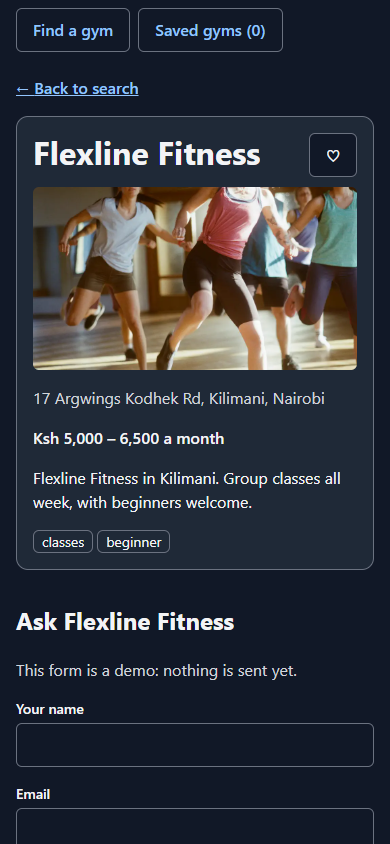
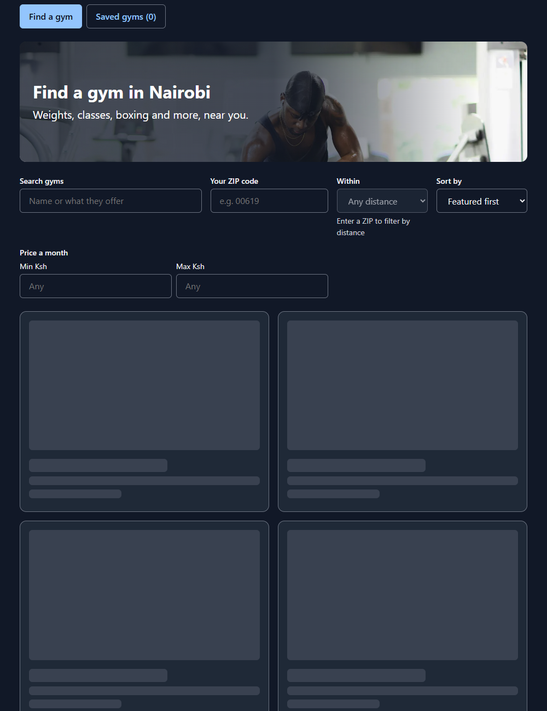
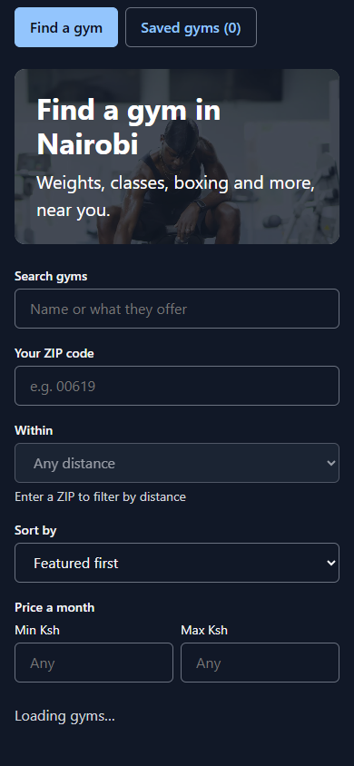
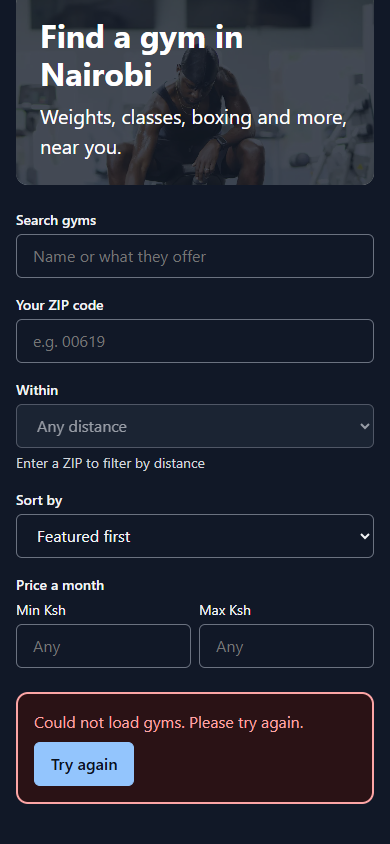

# Nairobi gyms directory

A searchable directory of gyms in and around Nairobi. You can search by name, filter by distance from your ZIP code, tags and monthly price, save favourites, and open a page for each gym with photos, similar gyms and an enquiry form.

This is Task 2 of my Crepton Tech trial (Directory Search UI). It is frontend only for now. The data is a local JSON file behind a fake API, and Task 3 will replace it with a Django backend.

**Live site:** https://directory-app-two.vercel.app

> Everything here is made up: the gym names, addresses, coordinates and prices are invented. Photos are free Unsplash photos, credited in [CREDITS.md](CREDITS.md).

## Screenshots

| Desktop | Phone (390 px) |
|---|---|
|  |  |
|  |  |
| |  |

### Loading, empty and error states

The fake API waits half a second before it answers, so the loading state is easy to see. To see the error state, open the site with `?fail=1` in the address. The first load then fails, and **Try again** works.

| State | Desktop | Phone |
|---|---|---|
| Loading |  |  |
| Empty (nothing matches) |  |  |
| Error |  |  |

## What it does

- **Search box:** matches gym names and what they offer. The search runs 0.3 seconds after the last letter, or at once when you press Enter.
- **Distance:** type your ZIP code and pick 5, 10, 25 or 50 km. A gym exactly on the edge counts as inside. Without a ZIP, or with one we don't know, every gym shows. An unknown ZIP shows a "Did you mean…?" list instead of guessing.
- **Tags:** tick one or more. A gym must have **all** the ticked tags.
- **Price a month:** Min Ksh and Max Ksh, and either box can be left empty. If Min is more than Max, the page says so and shows all gyms.
- **Sort:** featured first, cheapest, or nearest. Ties go A to Z by name.
- **12 at a time:** **Load more** adds 12 more and moves keyboard focus to the first new gym. Any new search goes back to the first 12.
- **Everything is in the address.** For example `/?q=fit&tags=weights&min=2000&page=2`. A reload, the Back button or a shared link shows the same results. A broken value in the address (like `?page=abc`) falls back to the default instead of breaking the page.
- **Gym page** at `/listing/<slug>`: a photo gallery, full details, up to 3 similar gyms (most shared tags first), and an enquiry form. The form is a demo, so nothing is sent.
- **Saved gyms** at `/favourites`: the heart button saves a gym in this browser (`localStorage`). A saved gym that no longer exists shows a "no longer available" card.

## Run it yourself

You need [Node.js](https://nodejs.org) 22 or newer.

```bash
git clone https://github.com/Danny3929/directory-app.git
cd directory-app/frontend
npm install
npm run dev        # opens on http://localhost:5173
```

Other commands, all run inside `frontend/`:

| Command | What it does |
|---|---|
| `npm test` | runs all the Vitest tests once |
| `npm run lint` | checks the code with Oxlint |
| `npm run build` | makes the production files in `frontend/dist/` |
| `npm run preview` | serves that build locally |

## How the code is organised

```
frontend/src/
  api/listings.js     the only place that reads the data (fake API with a delay)
  data/               listings.json (45 gyms) and zips.json
  lib/                plain functions with no React: search, filters, sorting,
                      distance (geo.js), URL reading and writing (urlState.js),
                      favourites, similar gyms, form checks
  components/         GymCard, FavouriteButton, PhotoGallery, EnquiryForm
  pages/              SearchPage, DetailPage, FavouritesPage
  App.jsx             top menu and the three routes (React Router)
```

**Swappable data layer:** no page or component imports the JSON files. They all call `fetchListings`, `fetchListing(slug)`, `fetchZips`, `fetchTagCounts` and `fetchSimilarListings(slug)` in `src/api/listings.js`. In Task 3, only the inside of that file changes to real HTTP calls.

The search and filter rules are plain functions in `src/lib/`, tested on their own before any screen was built.

## Tests

`npm test` output (19 files, 245 tests):

```
 RUN  v5.1.0 C:/Users/hp/crepton/directory-app/frontend

 ✓ src/lib/search.test.js (30 tests)
 ✓ src/lib/price.test.js (10 tests)
 ✓ src/lib/gymImage.test.js (13 tests)
 ✓ src/data/data.test.js (10 tests)
 ✓ src/lib/similar.test.js (8 tests)
 ✓ src/api/listings.test.js (13 tests)
 ✓ src/lib/route.test.js (6 tests)
 ✓ src/lib/urlState.test.js (20 tests)
 ✓ src/lib/enquiry.test.js (13 tests)
 ✓ src/lib/geo.test.js (5 tests)
 ✓ src/lib/tags.test.js (1 test)
 ✓ src/lib/favourites.test.js (8 tests)
 ✓ src/components/FavouriteButton.test.jsx (4 tests)
 ✓ src/components/PhotoGallery.test.jsx (7 tests)
 ✓ src/components/EnquiryForm.test.jsx (9 tests)
 ✓ src/pages/FavouritesPage.test.jsx (4 tests)
 ✓ src/pages/DetailPage.test.jsx (18 tests)
 ✓ src/App.test.jsx (17 tests)
 ✓ src/pages/SearchPage.test.jsx (41 tests)

 Test Files  19 passed (19)
      Tests  245 passed (245)
```

(Lines shortened: the timings are removed. Made with `npm test -- --reporter=tree` on 15 Nov 2026.)

The edge cases the guide asks for are covered, for example:

- **No results:** `search.test.js`, "returns an empty list when nothing matches"
- **Equal distances:** `search.test.js`, "sorts gyms A to Z by name when distances are equal, whatever the input order"
- **Missing ZIP:** `search.test.js`, "keeps the original order when the ZIP is missing (no origin)" and "does nothing without a ZIP (no origin) or without a radius"
- **Haversine:** `geo.test.js` checks known distances and rejects missing coordinates instead of returning `NaN`.

**The tests can fail.** For each new feature, the tests were written first and failed before the code existed. After the code passed, the feature was broken on purpose (for example, letting a gym list itself as similar), and the tests caught it.

## Checks done by hand

In real Chrome, at phone width (390 px) and on desktop, and on a real Android phone in the Brave browser (tested on the live site by Dan, 2026-11-06):

- **Keyboard only:** tabbing through the search, gym and saved pages, the focus frame was always visible and focus never got stuck. Load more with Enter moved focus to gym 13, and "Back to search" brought back all 24 gyms.
- **Reload and shared links:** 11 different addresses (filters, `?page=3`, a broken page number, Min above Max, an unknown ZIP, no results, a load error, a missing gym, a missing page) each looked the same after a reload. None of them scrolled sideways.
- **Live site:** the home page, `?q=yoga`, `?zip=abc` and a photo file all return 200 on https://directory-app-two.vercel.app (checked 2026-11-20 by request only; the look was not re-checked on a screen).
- **Screen reader data (2026-11-20):** I printed the accessibility tree Chrome gives a screen reader for the search, gym and saved pages (a small script kept outside this repo). Every box has a label, filter and save buttons say on or off, the result count is announced politely, photos have descriptions, and the enquiry form is a named region. One problem, since fixed: on the search page the headings jumped from level 1 to level 3; they now go 1, 2, and 3 under Similar gyms.
- **Not checked yet:** listening to a real screen reader (NVDA or Narrator) speak the pages. The tree shows what it is given, not how it sounds.

## Accessibility problems found and fixed

- **Tab title:** every page's browser tab said "frontend", left over from the starter template. Each page now has its own title, like "Flexline Fitness | Nairobi gyms". Found during the keyboard and reload check.
- **Missing headings:** the "Page not found" and "Gym not found" screens had no main heading, so screen-reader users jumping by heading found nothing. Both have one now.
- **Wrong label on the distance box:** with an unknown ZIP, the switched-off box still said "5 km", as if a filter was on. It now says "Any distance". Spotted on a phone screenshot.
- More in [NOTES.md](NOTES.md).

## Explain-it

_My own answers, in my own words._

**1. What happens, step by step, from typing in the search box to the results changing?**

> When I type, the page waits a short moment (0.3 seconds) before doing anything, so it is not searching after every single letter. I learned this is called a "debounce". After the wait, my text gets put in the address bar at the top (the bit that looks like `?q=`). Then the page looks at that address to work out which gyms to show. I still find it odd that the address is what drives the results, but that is how it works.

**2. How does the haversine formula work in plain English? What is its accuracy limit?**

> Haversine is a way to find the distance between two spots on Earth. You give it two points, like where you are standing and where you want to go, and it tells you how far apart they are along the curve of the ground. I don't know all the fancy maths or map words yet. The way I picture it: if you drew a straight line through the Earth like a tunnel, that would be shorter. Haversine doesn't do the tunnel. It follows the roundness of the planet, like stretching a string over a globe. Maps, GPS and location apps use it so they don't pretend the world is flat. Its limit, as far as I understand it: it pretends the Earth is a perfect ball, but it is actually a bit squashed. So the answer is an estimate of the straight line between two points, not the distance you would drive on roads. For gyms only a few km apart, the mistake is very small.

**3. Why keep filter state in the URL instead of component state?**

> So that if I reload the page, press Back, or send the link to a friend, they see the same search. If the filters were only kept in React's memory (what I think is called "state"), they would disappear every time the page reloaded, and a shared link would just show everything.

**4. Why does keyboard focus move to the first new gym after Load more?** (my own extra question)

> Focus is where the keyboard is "pointing" on the page. Someone using only a keyboard or a screen reader cannot see the new gyms appear, so if focus stayed on the button they would not know anything changed. Moving it to the first new gym takes them straight there.

## What the AI got wrong

I built this with an AI assistant. Here is where it went wrong and how I noticed. The full list is in [NOTES.md](NOTES.md).

- It said Task 2 only needed a README and a deploy. When we checked against every line of the guide, the radius, tag and price filters, debounce, 12 per page, React Router pages, gallery, similar gyms, enquiry form and Favourites page were all still missing.
- It first used `#/gym/3` style addresses instead of the React Router routes the guide asks for.
- On a 390 px phone, the Max price box ran off the right edge of the screen. We spotted it on a screenshot.
- Its first skeleton test looked for the "Loading gyms…" words to be gone, but they stay for screen readers (hidden on screen). The test was wrong, not the page.
- Its first version of Similar gyms hid the whole section while reloading after "Try again", which lost keyboard focus. A test caught it.

## Known limits

- Coordinates and prices are invented and were not checked on a map.
- Only 9 stock photos, so similar gyms often share a photo. Task 3's uploads will fix this.
- Distance is "as the crow flies", not by road.
