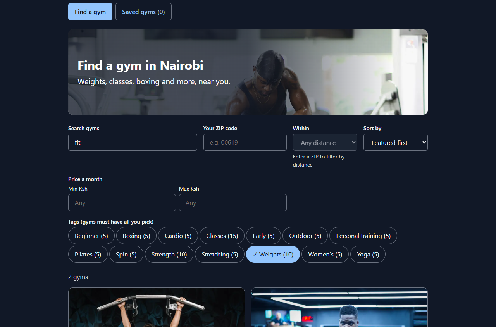
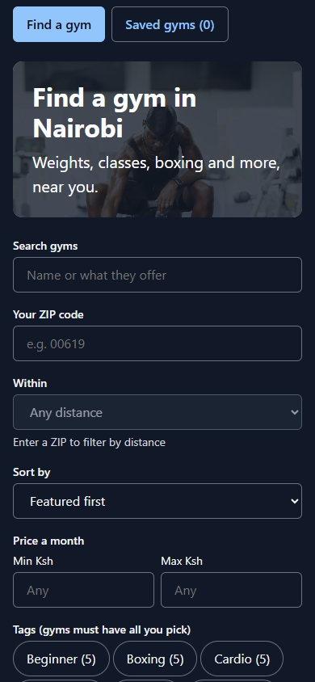
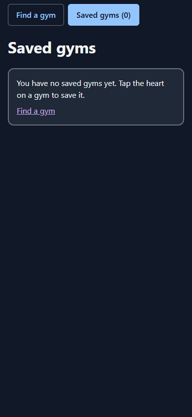
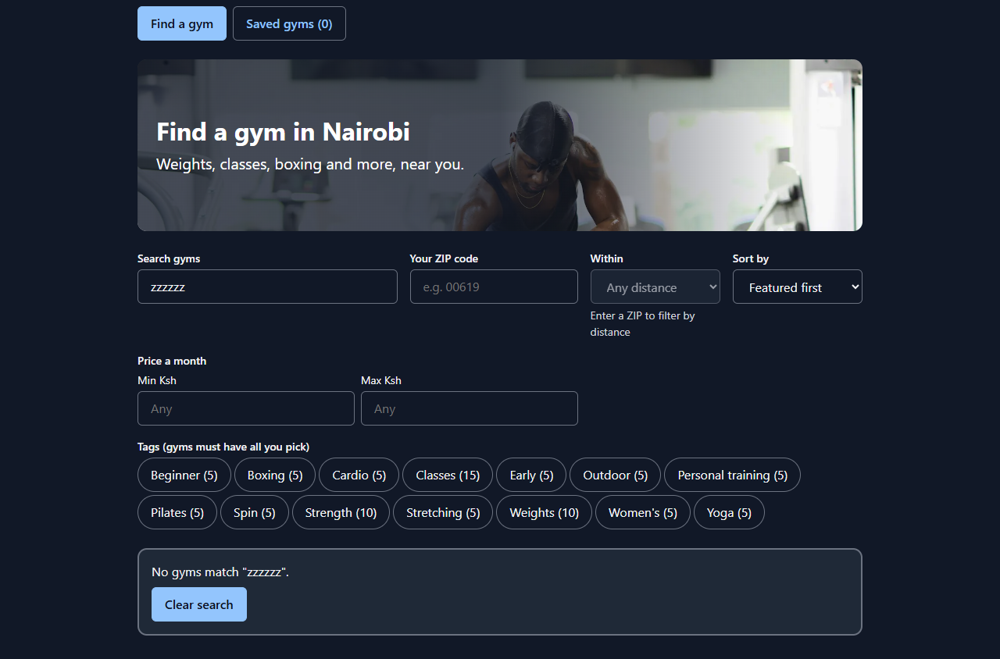
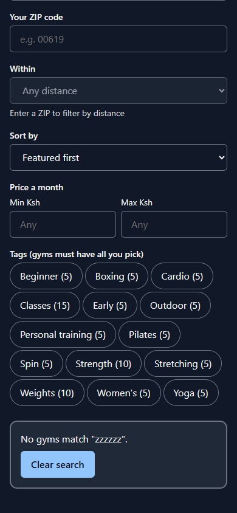
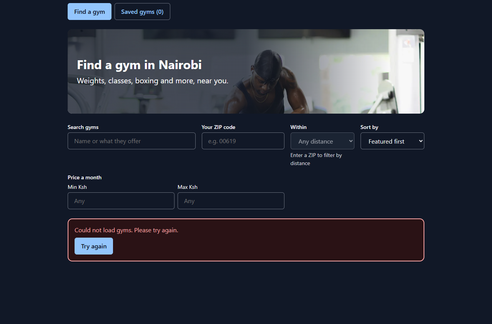

# Nairobi gyms directory

A searchable directory of gyms in and around Nairobi. You can search by name, filter by distance from your ZIP code, tags and monthly price, save favourites, and open a page for each gym with photos, similar gyms and an enquiry form.

This is Tasks 2 and 3 of my Crepton Tech trial (Directory Search UI, then Django REST API). The React frontend in `frontend/` reads its gyms from a Django REST API in `backend/`. The gym data started as a local JSON file and is now loaded into the database with `seed_listings`.

**Live site:** https://directory-app-two.vercel.app

> Everything here is made up: the gym names, addresses, coordinates and prices are invented. Photos are free Unsplash photos, credited in [CREDITS.md](CREDITS.md).

## Screenshots

| Desktop | Phone (390 px) |
|---|---|
|  |  |
|  |  |
| |  |

### Loading, empty and error states

These screenshots were taken in Task 2 with the fake API, which waited half a second so the loading state was easy to see. With the real API, the loading state shows while the request runs, and the error state shows if the backend is stopped. You can still force the error state by opening the site with `?fail=1` in the address; **Try again** then works.

| State | Desktop | Phone |
|---|---|---|
| Loading |  |  |
| Empty (nothing matches) |  |  |
| Error |  |  |

## What it does

- **Search box:** matches gym names and what they offer. The search runs 0.3 seconds after the last letter, or at once when you press Enter.
- **Distance:** type your ZIP code and pick 5, 10, 25 or 50 km. A gym exactly on the edge counts as inside. Without a ZIP, or with one we don't know, every gym shows. An unknown ZIP shows a "Did you mean…?" list instead of guessing.
- **Tags:** tick one or more. A gym must have **all** the ticked tags.
- **Price a month:** Min Ksh and Max Ksh, and either box can be left empty. If Min is more than Max, the page says so and shows all gyms.
- **Sort:** featured first, cheapest, or nearest. Ties go A to Z by name.
- **12 at a time:** **Load more** adds 12 more and moves keyboard focus to the first new gym. Any new search goes back to the first 12.
- **Everything is in the address.** For example `/?q=fit&tags=weights&min=2000&page=2`. A reload, the Back button or a shared link shows the same results. A broken value in the address (like `?page=abc`) falls back to the default instead of breaking the page.
- **Gym page** at `/listing/<slug>`: a photo gallery, full details, up to 3 similar gyms (most shared tags first), and an enquiry form. The form sends the message to the API, which checks it again and allows 5 per hour.
- **Saved gyms** at `/favourites`: the heart button saves a gym in this browser (`localStorage`). A saved gym that no longer exists shows a "no longer available" card.

## Run it yourself

You need [Node.js](https://nodejs.org) 22 or newer and [Python](https://www.python.org) 3.12 or newer. Start the backend first, then the frontend. Use two terminals.

### 1. Backend (Django API)

```bash
git clone https://github.com/Danny3929/directory-app.git
cd directory-app/backend
python -m venv .venv
.venv\Scripts\activate             # Mac/Linux: source .venv/bin/activate
pip install -r requirements.txt
copy .env.example .env             # Mac/Linux: cp .env.example .env
```

Open `backend/.env` and put your own secret key on the `DJANGO_SECRET_KEY` line. Make one with `python -c "import secrets; print(secrets.token_urlsafe(50))"`. Never commit `.env`. Then:

```bash
python manage.py migrate
python manage.py seed_listings     # loads the 45 gyms; safe to run twice
python manage.py createsuperuser   # optional, for the admin at /admin/
python manage.py runserver         # http://localhost:8000
```

If port 8000 is already taken on your computer, run `python manage.py runserver 8010` and set `VITE_API_URL=http://localhost:8010/api` in `frontend/.env`.

Check it works: open <http://localhost:8000/api/health/> (you should see `{"status": "ok"}`) and <http://localhost:8000/api/docs/> (Swagger page).

### 2. Frontend

```bash
cd directory-app/frontend
copy .env.example .env             # Mac/Linux: cp .env.example .env
npm install
npm run dev        # opens on http://localhost:5173
```

`VITE_API_URL` in `frontend/.env` is the address of the API. If the backend is stopped, the pages show "Could not load gyms. Please try again."

Test commands: `python -m pytest` inside `backend/` (76 tests) and `npm test` inside `frontend/` (263 tests).

Other frontend commands, all run inside `frontend/`:

| Command | What it does |
|---|---|
| `npm test` | runs all the Vitest tests once |
| `npm run lint` | checks the code with Oxlint |
| `npm run build` | makes the production files in `frontend/dist/` |
| `npm run preview` | serves that build locally |

## Backend (Task 3)

Django 6, Django REST Framework, django-filter, django-cors-headers, drf-spectacular and pytest-django. SQLite on a laptop; set `DATABASE_URL` for another database.

**Data model**

| Model | What it holds |
|---|---|
| `Tag` | name, slug. Many-to-many with `Listing` |
| `Listing` | name, slug, description, address, area, city, zip code, latitude, longitude, price min and max (whole shillings), `featured_until`, `is_published`, `owner` (empty until Task 4) |
| `ListingImage` | the gym, image, alt text, position. Deleted with its gym |
| `Enquiry` | the gym, name, email, message, `is_read`. A gym with enquiries cannot be deleted, so staff unpublish it instead |

"Featured" means `featured_until` is in the future, so nothing has to run to expire it.

**Endpoints** (all under `/api/`)

| Method and path | What it does |
|---|---|
| `GET /listings/` | 12 per page, featured first, then by name. Filters: `search`, `tags`, `price_min`, `price_max`, `zip`, `ordering`, and `lat` + `lng` + `radius_km` (adds `distance_km`) |
| `GET /listings/{slug}/` | one gym with its photos and tags |
| `POST /listings/{slug}/enquiries/` | public; checked on the server; 5 per hour per IP; returns 201 |
| `GET /tags/` | all tags |
| `GET /health/` | `{"status": "ok"}` |
| `GET /schema/`, `GET /docs/` | OpenAPI file and Swagger page |

Only published gyms are shown. Hidden gyms give 404. Every error has the same shape, `{"error": {"code", "message", "fields"}}`, and no stack trace reaches the visitor. The distance and featured rules live in `listings/services.py`, not in the views.

**Settings (environment variables)**

| Variable | What it does |
|---|---|
| `DJANGO_SECRET_KEY` | required; the server will not start without it |
| `DJANGO_DEBUG` | `False` unless set to `True` |
| `DJANGO_ALLOWED_HOSTS` | comma-separated hosts |
| `CORS_ALLOWED_ORIGINS` | comma-separated frontend addresses |
| `DATABASE_URL` | optional; leave out to use `backend/db.sqlite3` |

**Backend tests:** `python -m pytest` inside `backend/` runs 76 tests (enquiries 18, listings 13, seed command 9, distance and featured rules 9, models 7, settings 7, tags/health/docs 6, admin 5). They cover each filter, the distance radius, 12 per page, enquiry checks, the 5-per-hour limit, a query count limit (`django_assert_max_num_queries`), and hidden gyms. To prove they can fail, I broke the all-or-nothing seed, the hidden-gym rule and the price-overlap rule on purpose, and a test failed each time.

**Known limits**

- Search and filters still run in the browser. The API's own filters are built and tested but the pages do not use them yet.
- The limit of 5 enquiries per hour counts by IP address. Behind a proxy every visitor can look like one IP, so this needs `NUM_PROXIES` set when the API is deployed (Task 5).
- The API's paths are `/api/...`, not `/api/v1/...` as in the guide.

## How the code is organised

```
frontend/src/
  api/listings.js     the only place that reads the data (calls the Django API; ZIP codes still come from a local file)
  data/               listings.json (45 gyms) and zips.json
  lib/                plain functions with no React: search, filters, sorting,
                      distance (geo.js), URL reading and writing (urlState.js),
                      favourites, similar gyms, form checks
  components/         GymCard, FavouriteButton, PhotoGallery, EnquiryForm
  pages/              SearchPage, DetailPage, FavouritesPage
  App.jsx             top menu and the three routes (React Router)
```

**Swappable data layer:** no page or component imports the JSON files. They all call `fetchListings`, `fetchListing(slug)`, `fetchZips`, `fetchTagCounts` and `fetchSimilarListings(slug)` in `src/api/listings.js`. In Task 3, only the inside of that file changed, to real HTTP calls (`VITE_API_URL`), and `toGym()` turns the API's snake_case fields into the shape the pages use.

The search and filter rules are plain functions in `src/lib/`, tested on their own before any screen was built.

## Tests

`npm test` output from Task 2 (19 files, 245 tests; it is now 263 with the API tests, and the commands are above):

```
 RUN  v5.1.0 C:/Users/hp/crepton/directory-app/frontend

 ✓ src/lib/search.test.js (30 tests)
 ✓ src/lib/price.test.js (10 tests)
 ✓ src/lib/gymImage.test.js (13 tests)
 ✓ src/data/data.test.js (10 tests)
 ✓ src/lib/similar.test.js (8 tests)
 ✓ src/api/listings.test.js (13 tests)
 ✓ src/lib/route.test.js (6 tests)
 ✓ src/lib/urlState.test.js (20 tests)
 ✓ src/lib/enquiry.test.js (13 tests)
 ✓ src/lib/geo.test.js (5 tests)
 ✓ src/lib/tags.test.js (1 test)
 ✓ src/lib/favourites.test.js (8 tests)
 ✓ src/components/FavouriteButton.test.jsx (4 tests)
 ✓ src/components/PhotoGallery.test.jsx (7 tests)
 ✓ src/components/EnquiryForm.test.jsx (9 tests)
 ✓ src/pages/FavouritesPage.test.jsx (4 tests)
 ✓ src/pages/DetailPage.test.jsx (18 tests)
 ✓ src/App.test.jsx (17 tests)
 ✓ src/pages/SearchPage.test.jsx (41 tests)

 Test Files  19 passed (19)
      Tests  245 passed (245)
```

(Lines shortened: the timings are removed. Made with `npm test -- --reporter=tree` on 15 Nov 2026.)

The edge cases the guide asks for are covered, for example:

- **No results:** `search.test.js`, "returns an empty list when nothing matches"
- **Equal distances:** `search.test.js`, "sorts gyms A to Z by name when distances are equal, whatever the input order"
- **Missing ZIP:** `search.test.js`, "keeps the original order when the ZIP is missing (no origin)" and "does nothing without a ZIP (no origin) or without a radius"
- **Haversine:** `geo.test.js` checks known distances and rejects missing coordinates instead of returning `NaN`.

**The tests can fail.** For each new feature, the tests were written first and failed before the code existed. After the code passed, the feature was broken on purpose (for example, letting a gym list itself as similar), and the tests caught it.

## Checks done by hand

In real Chrome, at phone width (390 px) and on desktop:

- **Keyboard only:** tabbing through the search, gym and saved pages, the focus frame was always visible and focus never got stuck. Load more with Enter moved focus to gym 13, and "Back to search" brought back all 24 gyms.
- **Reload and shared links:** 11 different addresses (filters, `?page=3`, a broken page number, Min above Max, an unknown ZIP, no results, a load error, a missing gym, a missing page) each looked the same after a reload. None of them scrolled sideways.
- **Not checked yet:** a real screen reader, and shared links on the live site.

## Accessibility problems found and fixed

- **Tab title:** every page's browser tab said "frontend", left over from the starter template. Each page now has its own title, like "Flexline Fitness | Nairobi gyms". Found during the keyboard and reload check.
- **Missing headings:** the "Page not found" and "Gym not found" screens had no main heading, so screen-reader users jumping by heading found nothing. Both have one now.
- **Wrong label on the distance box:** with an unknown ZIP, the switched-off box still said "5 km", as if a filter was on. It now says "Any distance". Spotted on a phone screenshot.
- More in [NOTES.md](NOTES.md).

## Explain-it

_My own answers, in my own words._

**1. What happens, step by step, from typing in the search box to the results changing?**

> When I type, the page waits a short moment (0.3 seconds) before doing anything, so it is not searching after every single letter. I learned this is called a "debounce". After the wait, my text gets put in the address bar at the top (the bit that looks like `?q=`). Then the page looks at that address to work out which gyms to show. I still find it odd that the address is what drives the results, but that is how it works.

**2. How does the haversine formula work in plain English? What is its accuracy limit?**

> Haversine is a way to find the distance between two spots on Earth. You give it two points, like where you are standing and where you want to go, and it tells you how far apart they are along the curve of the ground. I don't know all the fancy maths or map words yet. The way I picture it: if you drew a straight line through the Earth like a tunnel, that would be shorter. Haversine doesn't do the tunnel. It follows the roundness of the planet, like stretching a string over a globe. Maps, GPS and location apps use it so they don't pretend the world is flat. Its limit, as far as I understand it: it pretends the Earth is a perfect ball, but it is actually a bit squashed. So the answer is an estimate of the straight line between two points, not the distance you would drive on roads. For gyms only a few km apart, the mistake is very small.

**3. Why keep filter state in the URL instead of component state?**

> So that if I reload the page, press Back, or send the link to a friend, they see the same search. If the filters were only kept in React's memory (what I think is called "state"), they would disappear every time the page reloaded, and a shared link would just show everything.

**4. Why does keyboard focus move to the first new gym after Load more?** (my own extra question)

> Focus is where the keyboard is "pointing" on the page. Someone using only a keyboard or a screen reader cannot see the new gyms appear, so if focus stayed on the button they would not know anything changed. Moving it to the first new gym takes them straight there.

### Task 3 questions

_Picked from multiple-choice cards, as Joy allowed, then written up in my words._

**5. What is an N+1 query? Show where one could have happened in your code and how you avoided it.**

> N+1 means one query to get the list of gyms, then one more query for every gym to get its tags and photos. So 12 gyms would be about 25 queries instead of a few. It could have happened in `GET /listings/`. I avoided it with `prefetch_related("tags", "images")`, which loads all the tags and photos for the page in one go. A test checks the list page uses 4 queries at most.

**6. What is the difference between a serializer and a viewset? Why are they separate?**

> The serializer decides what a gym looks like as JSON, and it checks data coming in, like an enquiry's email. The viewset decides which URLs exist, who can call them, and which gyms to fetch (only published ones). They are separate so each does one job: I can change the JSON shape without touching the URLs, and use the same serializer in more than one place.

**7. Why throttle the enquiry endpoint, and what could still go wrong?**

> Anyone can send an enquiry without logging in, so a bot could flood gym owners with thousands of messages. The limit is 5 per hour per IP address. What can still go wrong: a spammer with many IP addresses gets around it; people sharing one IP (an office, or every visitor behind a proxy until `NUM_PROXIES` is set in Task 5) can block each other; and 5 spam messages an hour still get through.

**8. (my own extra question) Why are a gym's tags many-to-many, but its photos one-to-many?**

> One tag, like "weights", belongs to many gyms, and one gym has many tags, so both sides have many: many-to-many. A photo belongs to only one gym, so that is one-to-many, and when a gym is deleted its photos go with it.

## What the AI got wrong

I built this with an AI assistant. Here is where it went wrong and how I noticed. The full list is in [NOTES.md](NOTES.md).

- It said Task 2 only needed a README and a deploy. When we checked against every line of the guide, the radius, tag and price filters, debounce, 12 per page, React Router pages, gallery, similar gyms, enquiry form and Favourites page were all still missing.
- It first used `#/gym/3` style addresses instead of the React Router routes the guide asks for.
- On a 390 px phone, the Max price box ran off the right edge of the screen. We spotted it on a screenshot.
- Its first skeleton test looked for the "Loading gyms…" words to be gone, but they stay for screen readers (hidden on screen). The test was wrong, not the page.
- Its first version of Similar gyms hid the whole section while reloading after "Try again", which lost keyboard focus. A test caught it.

## Known limits

- Coordinates and prices are invented and were not checked on a map.
- Each gym has its own card photo, but the gallery photos are shared stock photos. Task 4's uploads will fix this.
- Distance is "as the crow flies", not by road.
